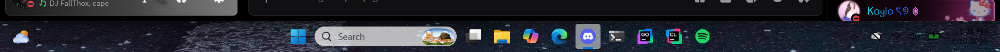

# Glassbar

A tiny Windows 11 taskbar-transparency mod written in x86-64 NASM.

Glassbar does not rewrite XAML, patch code, or hide the taskbar window. It finds
the live `TaskbarFrame` on the Explorer UI thread, walks the verified first-child
path to the `BackgroundFill` rectangle, and assigns a transparent
`SolidColorBrush` through `IShape::put_Fill(IBrush*)`.



## Run

Keep these two files together and run `glassbar.exe`:

- `glassbar.exe`
- `glassbar_direct.dll`

The executable is a toggle. The first run makes the taskbar transparent. The
second run restores the exact original brush object captured from Explorer.
No Explorer restart is required.

## Build

Install NASM and an x64 MinGW toolchain, then run:

```bat
build.bat
```

The build produces `build\glassbar.exe` and `build\glassbar_direct.dll`. Both
the injector and injected runtime are handwritten NASM; MinGW is used only as
the PE linker/import-library driver.

The C++ proof used to validate the COM path before translation is retained in
`test\glassbar_test.cpp`.

## Compatibility and safety

This revision intentionally supports one exact system image:

- Windows 11 24H2, build `26100.9444`
- `taskbar.dll` timestamp `2378140881`
- image size `3162112`
- SHA-256 `5dceea036939acb4e43b801a7a63530f328edad164741e6529d3d32e9b1c5866`
- matching `taskbar.dll` PDB `483327DB5FAC66CA1D844F9D8F5054CB`, age 1

The DLL validates the PE timestamp and image size before touching private
state. Unknown builds fail closed. The two private vtable RVAs were recovered
from the matching Microsoft PDB with Windissect:

- `TrayUI` (`ITrayUI`/`ITrayComponentHost` implementation): `0x1CAE88`
- `std::_Ref_count_obj2<TaskbarHost>`: `0x1C52A0`

After locating the root, mutation uses Windows Runtime COM interfaces rather
than private method calls. The replacement is read back and compared by
canonical `IUnknown` identity before success is reported to the runner.

## License

MIT. See `LICENSE`.
